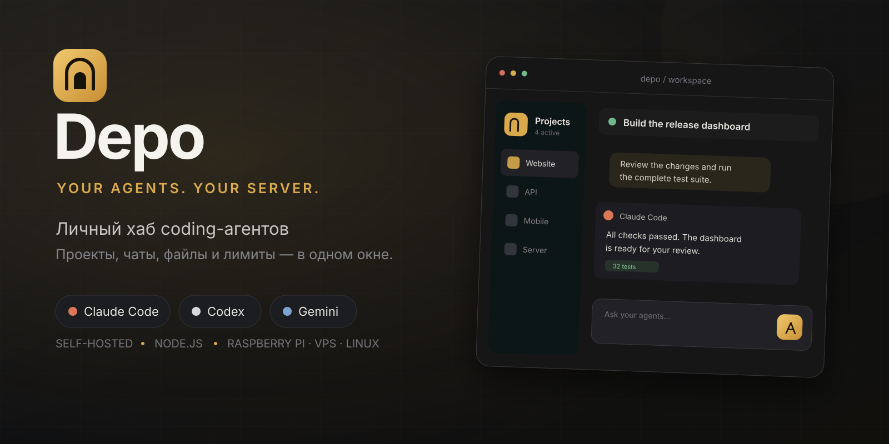

# Depo

**Самостоятельный веб-хаб для Claude Code, Codex, Gemini и Kimi Code.** Depo объединяет проекты, чаты, файлы, лимиты и уведомления в одном интерфейсе, который работает на вашем сервере и открывается с компьютера или телефона.

[](https://github.com/banhanman/depo/actions/workflows/test.yml)
[](https://nodejs.org/)
[](LICENSE)
[](https://github.com/banhanman/depo)

**English:** Depo is a self-hosted web UI for managing Claude Code, Codex, Gemini CLI and Kimi Code projects on a Raspberry Pi, home server, VPS or Linux workstation. It uses your existing CLI accounts, keeps project data on your machine and requires no npm runtime dependencies.

## Для чего нужен Depo

Работа с несколькими coding-агентами обычно разрознена: у каждого свой терминал, сессии и контекст. Depo собирает их в единое рабочее пространство, не заменяя официальные CLI и не требуя API-ключей.

Проект в Depo — это настоящая папка на сервере. Внутри неё живут отдельные чаты, файлы и история работы. Можно начать задачу в одном агенте, передать контекст другому, проверить изменения и открыть нужный файл из браузера.

Depo подходит для Raspberry Pi, домашнего мини-сервера, VPS или обычной Linux-машины. Интерфейс адаптирован для компьютера и телефона, поддерживает установку как PWA.

## Возможности

- **Claude Code, Codex, Gemini и Kimi Code в одном окне.** Переключение между подключёнными аккаунтами без повторного входа при каждом запуске.
- **Вход через официальные CLI.** Depo запускает стандартный процесс авторизации и показывает его в браузере. API-ключи вводить не нужно.
- **Проекты и изолированные чаты.** Создание, закрепление, переименование, архивирование и удаление чатов внутри каждого проекта.
- **Передача задачи между агентами.** В новый чат передаются задача, затронутые файлы и последние шаги. Скрытые рассуждения моделей не копируются.
- **Два чата рядом.** Можно отвечать в одном разговоре, пока другой агент продолжает работу.
- **Файлы и Git.** Дерево проекта, просмотр файлов и изображений, подсвеченный Git diff, загрузка файлов перетаскиванием.
- **Вложения.** Скриншоты и файлы можно добавить кнопкой, из буфера обмена или перетаскиванием.
- **Доска состояний.** Видно, какие агенты работают, ждут разрешения или завершили задачу.
- **Разрешения из интерфейса.** Запросы CLI можно подтвердить или отклонить кнопкой, не возвращаясь в терминал.
- **Лимиты и контекст.** Depo показывает доступные данные об использовании аккаунта, модели и заполнении контекста.
- **Собеседник.** Можно спросить у отдельного агента, что происходит в задаче, не запуская изменения файлов.
- **Голосовой ввод.** Локальное распознавание через Vosk и Whisper; поддерживается русская речь.
- **Telegram-уведомления.** Статусы, ответы и подтверждение разрешений из Telegram после настройки бота.
- **PWA и уведомления.** Depo можно установить на домашний экран телефона.
- **Резервные копии.** Согласованные снимки SQLite и вложений с автоматической ротацией.
- **Локальная история.** Markdown-копии разговоров сохраняются в `.depo/chats` внутри проекта и исключаются из Git.

## Быстрая установка одной командой

Требуется Linux с systemd, `curl`, `git`, `tar` и `sudo`. Поддерживаются архитектуры x86_64, ARM64 и ARMv7. Установщик проверит Node.js и при необходимости скачает совместимую версию в домашний каталог с проверкой SHA-256.

```bash
curl -fsSL https://raw.githubusercontent.com/banhanman/depo/main/scripts/quick-install.sh | bash
```

Во время установки нужно ввести логин и пароль владельца. Пароль не отображается на экране и не сохраняется в открытом виде. По умолчанию Depo устанавливается в `~/depo`, настраивается на порт `4620` и запускается как служба `depo.service`.

После завершения откройте адрес, который покажет установщик:

```text
http://IP_ВАШЕГО_СЕРВЕРА:4620
```

Для другого каталога установки:

```bash
curl -fsSL https://raw.githubusercontent.com/banhanman/depo/main/scripts/quick-install.sh | DEPO_INSTALL_DIR="$HOME/apps/depo" bash
```

Не помещайте реальный пароль в URL, shell history или публичные скрипты. Для автоматической установки переменные `DEPO_LOGIN` и `DEPO_PASSWORD` следует передавать только через защищённое окружение.

## Первый запуск

1. Войдите с логином и паролем, указанными при установке.
2. Откройте настройки и подключите нужного агента.
3. Depo покажет официальную ссылку и код авторизации CLI.
4. Завершите вход на сайте провайдера.
5. Добавьте существующую папку или создайте новый проект.
6. Создайте чат и выберите агента у поля ввода.

Учётные данные сохраняются официальными CLI в их стандартных каталогах: `~/.claude`, `~/.codex`, `~/.gemini` и `~/.kimi-code`. Depo не просит вводить API-токены в веб-интерфейс.

## Управление службой

```bash
systemctl status depo
journalctl -u depo -f
sudo systemctl restart depo
```

Проверка состояния доступна по `GET /health`. Внутренний журнал также доступен в настройках Depo.

## Обновление

```bash
cd ~/depo
git pull --ff-only
sudo systemctl restart depo
```

Если Node.js был установлен локальным установщиком, обновление Depo не меняет его версию. Перед обновлением рекомендуется сделать резервную копию.

## HTTPS, микрофон и уведомления

Микрофон и системные уведомления браузеры обычно разрешают только в защищённом контексте. Для локального HTTPS выполните:

```bash
cd ~/depo
bash scripts/make-cert.sh
sudo systemctl restart depo
```

HTTPS будет доступен на порту `4621`. Скрипт создаёт локальный центр сертификации в `data/tls`; его сертификат доступен в Depo по адресу `/ca.crt`. Установите корневой сертификат на устройство и включите доверие к нему в настройках системы.

Не публикуйте самоподписанный HTTPS-порт напрямую в интернете. Для удалённого доступа используйте частную VPN-сеть или обратный прокси с нормальным TLS-сертификатом.

## Голосовой ввод

```bash
cd ~/depo
bash scripts/voice-install.sh
```

Для более точной, но значительно более тяжёлой модели:

```bash
bash scripts/voice-install.sh --big
```

Базовая установка загружает Vosk в `voice/venv` и небольшую русскую модель. Большая модель занимает около 1,8 ГБ. Распознавание выполняется на вашем сервере.

## Резервные копии

Таймер `depo-backup.timer` запускает копирование автоматически. По умолчанию архивы сохраняются в `~/backups/depo`, хранятся последние 14 копий.

```bash
cd ~/depo
npm run backup
```

Каталог и количество копий настраиваются в `.env`:

```dotenv
DEPO_BACKUP_DIR=/mnt/backups/depo
DEPO_BACKUP_KEEP=14
```

Для восстановления остановите службу, сохраните текущую папку `data`, затем верните `depo.db` и `uploads` из архива. После восстановления запустите `depo.service`.

## Конфигурация

Основные параметры находятся в `.env`, который исключён из Git:

```dotenv
HOST=0.0.0.0
PORT=4620
HTTPS_PORT=4621
DEPO_DATA_DIR=/home/user/depo/data
DEPO_BACKUP_DIR=/home/user/backups/depo
DEPO_BACKUP_KEEP=14
DEPO_VOICE_URL=http://127.0.0.1:2701
```

Готовый шаблон без секретов находится в [`.env.example`](.env.example). Настройки Telegram и провайдеров выполняются через интерфейс.

## Ручная установка

Если Node.js 22.5 или новее уже установлен:

```bash
git clone https://github.com/banhanman/depo.git ~/depo
cd ~/depo
DEPO_LOGIN=admin
read -rsp "Пароль: " DEPO_PASSWORD; echo
export DEPO_LOGIN DEPO_PASSWORD
npm run setup
unset DEPO_PASSWORD
sudo bash scripts/install.sh
```

Внешние npm-зависимости и сборка не нужны. Используются встроенные модули Node.js, включая `node:sqlite`.

## Безопасность

- Пароли хранятся в виде хешей scrypt с индивидуальной солью.
- Сессии передаются в `httpOnly`-куке; при HTTPS используется флаг `Secure`.
- После повторных неудачных попыток вход включается временная блокировка.
- Подключение проектов ограничено домашним каталогом пользователя.
- Каталоги `.ssh`, учётных данных CLI и данные Depo нельзя добавить как проекты.
- Сервер не выводит stack trace в браузер.
- База, загрузки, сертификаты, `.env` и резервные копии исключены из Git.

Depo предоставляет доступ к coding-агентам и файлам сервера, поэтому его не следует открывать всему интернету без дополнительной защиты. Используйте VPN, брандмауэр и уникальный пароль владельца.

## Как устроен проект

```text
server.mjs              HTTP API, статика, SSE и HTTPS
lib/db.mjs              SQLite-схема и запросы
lib/auth.mjs            Аутентификация и сессии
lib/runner.mjs          Запуск CLI и разбор потоковых ответов
lib/accounts.mjs        Аккаунты и профили провайдеров
lib/link.mjs            Авторизация CLI через браузер
lib/projects.mjs        Безопасные пути и проекты
lib/files.mjs           Файлы, просмотр и Git diff
lib/sessions.mjs        Импорт сессий Claude Code
lib/usage.mjs           Лимиты и контекст
lib/models.mjs          Модели и режимы разрешений
lib/companion.mjs       Собеседник без изменения файлов
lib/telegram.mjs        Telegram-интеграция
lib/snapshot.mjs        Markdown-копии разговоров
public/                 Интерфейс без сборки и PWA
voice/server.py         Локальное распознавание речи
scripts/                Установка, настройка и резервные копии
systemd/                Шаблоны служб и таймер
```

CLI запускается на один ход и завершается. История хранится в SQLite, поэтому перезапуск сервера не удаляет чаты. Незавершённый ход помечается как прерванный, а разговор можно продолжить из интерфейса.

Поток событий в браузер передаётся через SSE. Внешних frontend- или backend-зависимостей нет.

## Разработка и проверка

```bash
npm test
npm start
```

Тесты используют встроенный `node:test`. Основной сценарий разработки не требует `npm install`, Docker или отдельной базы данных.

## Удаление

```bash
cd ~/depo
sudo bash scripts/uninstall.sh
```

Удаляются только systemd-службы и таймер. Код, база, загрузки и резервные копии остаются на месте.

## Лицензия

[MIT](LICENSE). Названия и логотипы Claude, Codex, Gemini и Kimi принадлежат их владельцам. Depo является независимым self-hosted интерфейсом и использует официальные CLI, установленные пользователем.
