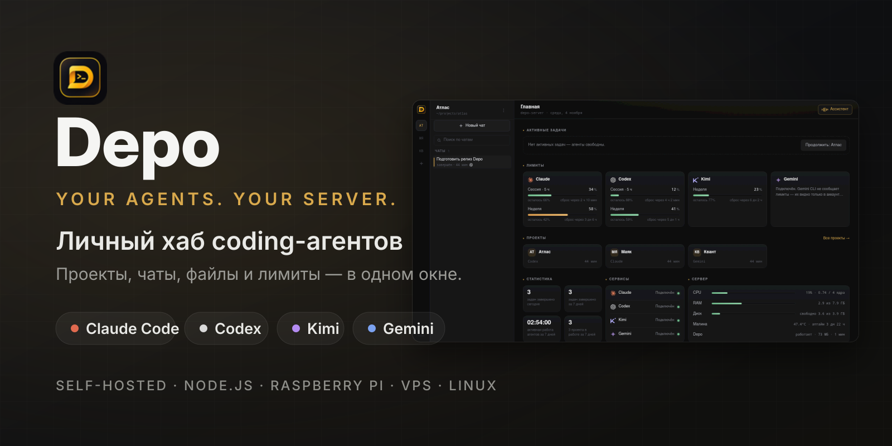
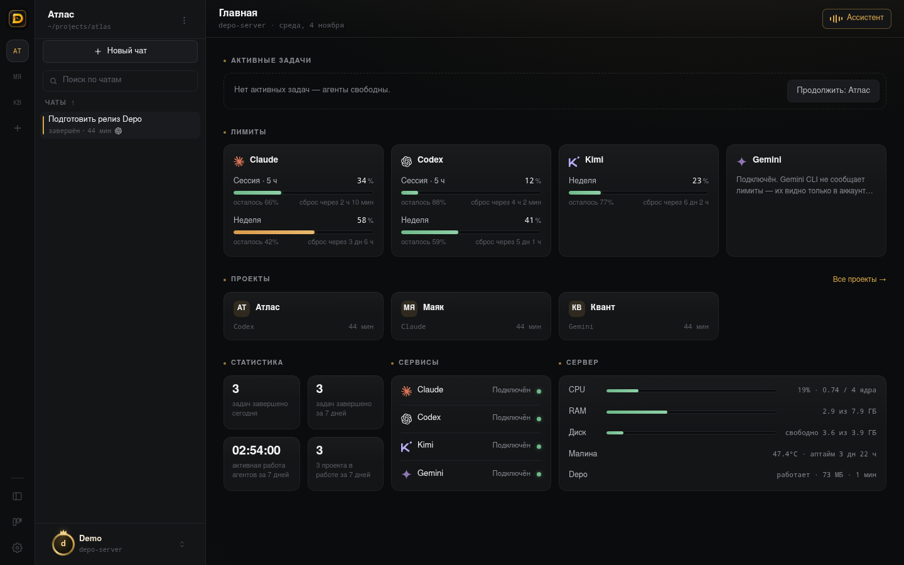
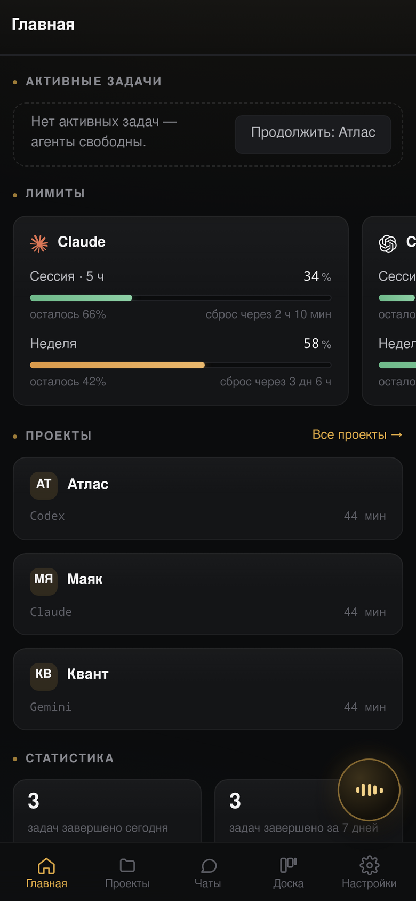
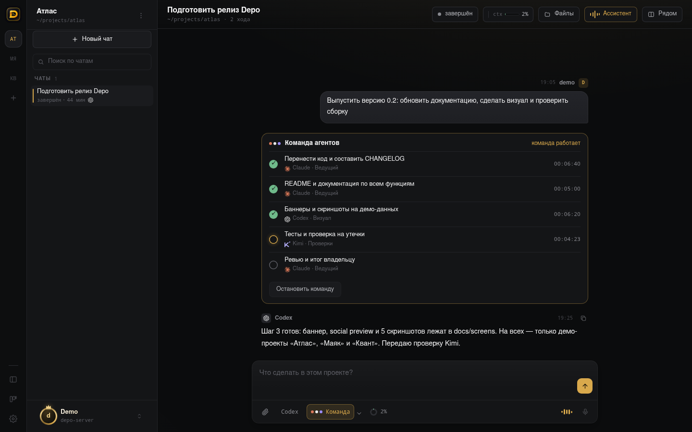
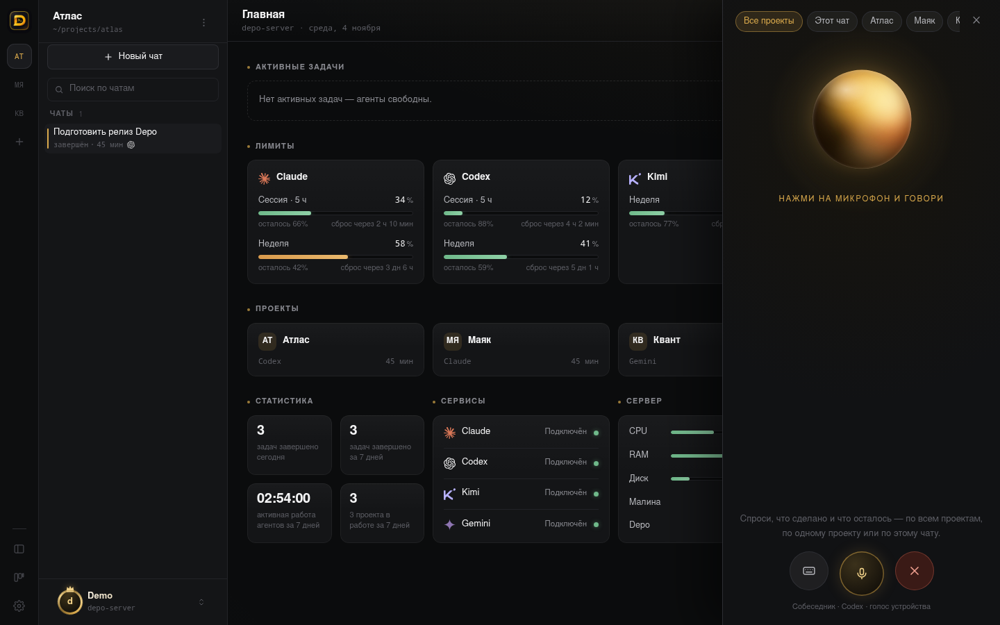
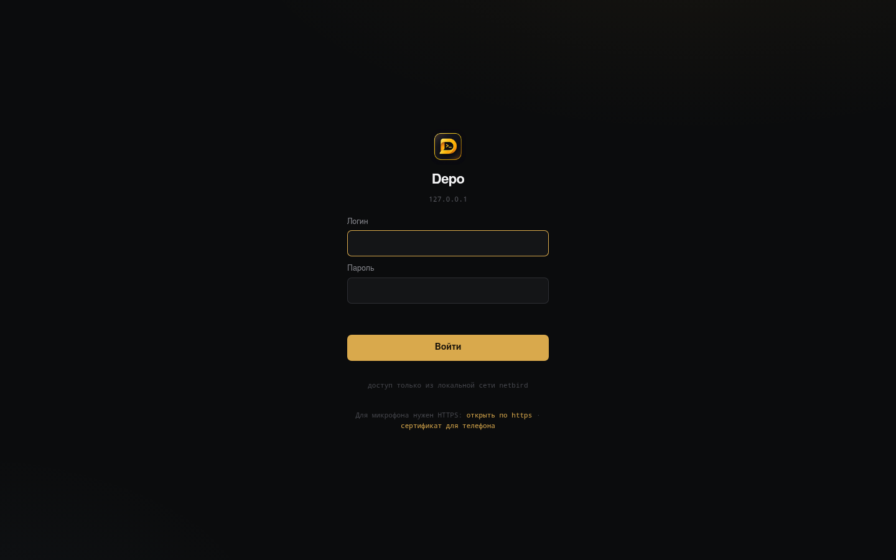

# Depo

**Свой хаб для Claude Code, Codex, Gemini и Kimi Code на твоём железе.** Проекты, чаты, файлы, лимиты, команда агентов и голосовой ассистент в одном интерфейсе. Работает на Raspberry Pi, мини-сервере, VPS или ноутбуке с Ubuntu, открывается с компьютера и с телефона.

[](https://github.com/banhanman/depo/actions/workflows/test.yml)
[](https://nodejs.org/)
[](LICENSE)
[](https://github.com/banhanman/depo/releases)
[](package.json)

**English:** Depo is a self-hosted web hub for Claude Code, Codex, Gemini CLI and Kimi Code. It runs on a Raspberry Pi, home server, VPS or Linux laptop. Agents sign in with your own CLI accounts, with no API keys. It has a multi-agent team mode, a voice assistant, web push and a Telegram bot, plus optional internet access through a relay with a decoy site. There are zero npm runtime dependencies.

| Рабочий стол | Телефон | Команда агентов |
|---|---|---|
|  |  |  |
| **Голосовой ассистент** | **Вход** | **Скрытый сайт снаружи** |
|  |  |  |

> Скриншоты сняты на демо-данных.

**Что нового в 0.2:** команда агентов, голосовой ассистент, доступ из интернета со скрытым сайтом, код из Telegram при входе, несколько аккаунтов у каждого агента, единый менеджер обновлений CLI, web push, новая главная и мобильная версия. Полный список изменений — в [CHANGELOG.md](CHANGELOG.md).

## Содержание

- [Возможности](#возможности)
- [Установка](#установка): Raspberry Pi, Ubuntu, VPS
- [Доступ: локальная сеть, HTTPS, интернет](#доступ)
- [Скрытый сайт и секретный вход](#скрытый-сайт-и-секретный-вход)
- [Голос](#голос) · [Telegram-бот](#telegram-бот) · [Резервные копии и уборка](#резервные-копии-и-уборка)
- [Конфигурация](#конфигурация) · [Безопасность](#безопасность) · [Как устроено](#как-устроено)

## Возможности

### Проекты и чаты
- **Проект — это настоящая папка** на сервере. Внутри у проекта свои чаты, дерево файлов, просмотр, Git diff и загрузка перетаскиванием.
- **Четыре агента в одном окне:** Claude Code, Codex, Gemini CLI и Kimi Code. Модель, уровень раздумий и режим разрешений выбираются у поля ввода.
- **Вход по своему аккаунту.** Depo запускает официальный вход CLI и показывает ссылку и код в браузере (`lib/link.mjs`). API-ключи не нужны.
- **Несколько аккаунтов у каждого агента** (`lib/accounts.mjs`): почта, тариф и лимиты у каждого, переключение в один клик.
- **Разрешения кнопкой.** Запросы CLI на действия подтверждаются в интерфейсе или в Telegram (`lib/approve-mcp.mjs`).
- **Уточнения на ходу** (`lib/queue.mjs`). Пока агент работает, ему можно дописать сообщение. Claude получает его сразу, Codex и Kimi — следующим ходом.
- **Кликабельные пути.** Пути к файлам в ответах агентов открываются прямо в браузере.

### Команда агентов
Режим команды (`lib/team.mjs`): одна задача выполняется несколькими агентами по очереди в одной папке.

1. Ведущий (обычно Claude Code) читает код и составляет план из шагов. Каждый шаг закреплён за ролью: «ядро», «интерфейс», «тесты».
2. Владелец утверждает план.
3. Шаги выполняют агенты своих ролей, например Codex — вёрстку, Kimi — тесты. Между шагами Depo передаёт контекст.
4. Если тесты упали, шаг возвращается исполнителю.
5. В конце ведущий делает ревью и пишет итог.

Роли, агенты и указания для каждой роли настраиваются.

### Ассистент и собеседник
- **Ассистент** (`lib/assistant.mjs`): кнопка-«волна» и живой голосовой разговор о проектах. Он знает, что делали агенты, что работает сейчас, что ждёт ответа и какой git-статус. Ничего не исполняет, только рассказывает. Секреты вырезаются до отправки.
- **Собеседник** (`lib/companion.mjs`): отдельный агент «только на чтение» объясняет, что происходит в задаче, и помогает сформулировать уточнение.

### Передача, память и уроки
- **Передача между агентами** (`lib/handoff.mjs`): новый агент получает задачу, затронутые файлы, фактический `git status`, коммиты и последние реплики. Скрытые рассуждения моделей не копируются.
- **Общая память проекта** (`lib/memory.mjs`): в `.depo/memory` хранятся контекст, архитектура, решения и `LESSONS.md` — уроки прошлых задач. Сводка подмешивается каждому агенту, после хода память обновляется сама.
- **Проверки и безопасная публикация** (`lib/safety.mjs`): в `.depo/checks.json` проекта задаются тесты, проверки после выкладки, команда публикации и откат. Кнопка «Опубликовать» сначала прогоняет проверки, а если выкладка не прошла проверку — откатывает.
- **Один пишущий агент на папку:** два агента не правят одну папку одновременно.
- **Markdown-копии разговоров** (`lib/snapshot.mjs`) лежат в `.depo/chats` и исключены из Git.

### Лимиты и обновления CLI
- **Лимиты и контекст** (`lib/usage.mjs`, `lib/codex-meta.mjs`, `lib/kimi-meta.mjs`): окна лимитов, процент контекста, стоимость хода. Лимиты Codex приходят живыми через `codex app-server`.
- **Единый менеджер обновлений** (`lib/cli-update.mjs`) для Claude Code, Codex, Kimi Code и Gemini CLI. Ставит только стабильные версии (выдержка npm 48 ч, канал stable у Claude), обновляет по одному агенту, занятого откладывает. Если новая версия сломалась, откатывается сама. Обёртки с прокси не перезаписывает.

### Главная, телефон, уведомления
- **Главная-дашборд:** активные задачи, лимиты, проекты, статистика, службы и карточка «Сервер» (`lib/sysinfo.mjs`: CPU, RAM, диск, температура, аптайм).
- **Мобильная версия:** экраны «Проекты» и «Чаты», жест «назад», нижняя навигация, поиск по чатам всех проектов, пин-код и отпечаток или Face ID (WebAuthn).
- **PWA:** установка на домашний экран, заставка.
- **Web push** (`lib/push.mjs`): системные уведомления о завершённых ходах и вопросах агентов. VAPID и шифрование aes128gcm сделаны на `node:crypto`, без внешних библиотек.

## Установка

Нужен Linux с systemd, `curl`, `git`, `tar` и `sudo`. Архитектуры: x86_64, ARM64, ARMv7. Node.js 22.5+ установщик проверит сам и при необходимости скачает в домашний каталог с проверкой SHA-256.

### Одной командой (Raspberry Pi, Ubuntu, Debian, VPS)

```bash
curl -fsSL https://raw.githubusercontent.com/banhanman/depo/main/scripts/quick-install.sh | bash
```

Установщик спросит логин и пароль владельца. Пароль хранится только хешем. Depo ставится в `~/depo`, слушает порт `4620` и запускается службой `depo.service`. Откройте `http://IP_СЕРВЕРА:4620`.

Свой каталог установки: `curl … | DEPO_INSTALL_DIR="$HOME/apps/depo" bash`.

| Где | Что учесть |
|---|---|
| **Raspberry Pi** (Pi 4/5, 64-bit OS) | Хватает 4 ГБ RAM. Голос на сервере — базовая модель Vosk. Температуру видно на главной и в Telegram `/pi`. |
| **Ubuntu / Debian** (ноутбук, мини-ПК) | Подходит как есть. Для доступа с телефона — NetBird или любая VPN. |
| **VPS** | Не открывайте порт 4620 в интернет. Ставьте за VPN или по схеме [проводника](docs/remote-access.md). |

### Вручную

```bash
git clone https://github.com/banhanman/depo.git ~/depo && cd ~/depo
DEPO_LOGIN=admin; read -rsp "Пароль: " DEPO_PASSWORD; echo
export DEPO_LOGIN DEPO_PASSWORD
npm run setup && unset DEPO_PASSWORD
sudo bash scripts/install.sh            # служба depo.service из systemd/
sudo bash scripts/install.sh --voice    # служба распознавания речи (после voice-install.sh)
```

`npm install` и сборка не нужны: используются только встроенные модули Node.js, включая `node:sqlite`.

### Первый запуск
1. Войдите с логином и паролем владельца.
2. В настройках подключите агентов: Depo покажет официальную ссылку и код входа CLI.
3. Добавьте существующую папку или создайте проект, откройте чат и выберите агента.

Учётные данные хранят сами CLI в своих каталогах (`~/.claude`, `~/.codex`, `~/.gemini`, `~/.kimi-code`). Эти каталоги нельзя подключить как проект.

### Служба и обновление

```bash
systemctl status depo; journalctl -u depo -f
cd ~/depo && git pull --ff-only && sudo systemctl restart depo
```

Проверка состояния: `GET /health`. Журнал есть и в настройках Depo. Удаление служб: `sudo bash scripts/uninstall.sh`, код и данные при этом остаются.

## Доступ

### Локальная сеть и VPN
По умолчанию Depo доступен в локальной сети. С телефона вне дома удобнее всего через [NetBird](https://netbird.io) (WireGuard): поставьте клиент на сервер и телефон и открывайте Depo по адресу из NetBird.

### HTTPS: свой центр сертификации
Микрофон, уведомления и отпечаток браузеры разрешают только по HTTPS.

```bash
bash scripts/make-cert.sh [IP]   # локальный CA и сертификат сервера в data/tls
sudo systemctl restart depo      # HTTPS на порту 4621
```

Корневой сертификат отдаётся по `/ca.crt`, его один раз ставят на телефон или ноутбук. Когда появляются новые адреса (IP проводника, имя в NetBird), Depo сам перевыпускает серверный сертификат тем же CA и подменяет его на лету (`lib/tlscert.mjs`). Переустанавливать что-то на телефоне не нужно.

### Из интернета через проводник
Чтобы открывать Depo с телефона без VPN, нужен **проводник** — недорогой VPS с NetBird и обратным прокси (`lib/remote.mjs`):

```
телефон ──https──▶ depo.example.org (VPS: Nginx Proxy Manager + Let's Encrypt)
        ──▶ socat ──туннель NetBird──▶ Depo :4620 дома
```

Готовый [`deploy/relay/docker-compose.yml`](deploy/relay/docker-compose.yml) содержит клиент NetBird и два пересыльщика. Скрипт [`deploy/relay/npm-add-host.mjs`](deploy/relay/npm-add-host.mjs) заводит хост в Nginx Proxy Manager. Пошагово — в [deploy/relay/README.md](deploy/relay/README.md) и [docs/remote-access.md](docs/remote-access.md).

Выключатель «Удалённый доступ» работает на самом Depo: при выключенном доступе запросы через домен получают пустую страницу, даже если проводник запущен. Его можно переключить и из Telegram-бота.

## Скрытый сайт и секретный вход

Через проводник Depo **не выдаёт себя**:

- на главной домена — обычный сайт-визитка ([`public/site/`](public/site/index.html)), его можно заменить своим;
- форма входа открывается только по **секретному адресу** (по умолчанию `/enter`, поменяйте в «Настройки → Доступ»);
- остальные адреса без входа отдают пустой 404 без имени и версии, а API — пустой 401;
- после заданного числа неверных паролей (от 1 до 5) удалённый доступ выключается сам. Включить его снова можно в настройках или в Telegram.

Как включить: «Настройки → Доступ» → домен, IP проводника, секретный адрес, порог неверных паролей → «Проверить снаружи» → включить. Подробнее — в [docs/remote-access.md](docs/remote-access.md).

### Код из Telegram на новом устройстве
Двухфакторная защита (`lib/twofa.mjs`). После верного пароля с нового устройства бот присылает 6-значный код. Код живёт 5 минут, даётся 3 попытки, хранится только хешем. Подтверждённое устройство запоминается. Сессия заканчивается после 14 дней без заходов, максимум через 90 дней.

## Голос

Три движка диктовки, выбираются для каждого устройства:

| Движок | Как работает | Установка |
|---|---|---|
| **На сервере** | Vosk (черновик) + Whisper (чистовик), звук не уходит наружу (`lib/voice.mjs`, `voice/server.py`) | `bash scripts/voice-install.sh` (`--big` — точная модель, ~1,8 ГБ) |
| **В браузере** | Web Speech API устройства (облако браузера) | не нужна |
| **ChatGPT через Codex** | голос ChatGPT через `codex app-server` под вашим входом в Codex, экспериментально (`lib/chatgpt-voice.mjs`) | не нужна |

## Telegram-бот

Бот подключается в настройках: токен и ваш chat id (`lib/telegram.mjs`). Что он умеет:
- присылать итоги длинных ходов, ошибки и вопросы агентов;
- подтверждать разрешения кнопками;
- присылать коды входа на новом устройстве;
- переключать удалённый доступ;
- показывать состояние машины по `/pi`. Список служб и дисков задаётся через `DEPO_TG_SERVICES` и `DEPO_TG_DISKS`.

## Резервные копии и уборка

- **Резервные копии:** `depo-backup.timer` делает согласованный снимок SQLite и вложений в `~/backups/depo` и хранит последние 14. Вручную — `npm run backup`. Чтобы восстановить, остановите службу и верните `depo.db` и `uploads` в `data/`.
- **Уборка** (`lib/housekeeping.mjs`): чтобы Depo годами жил на маленьком диске, журнал и старые длинные выводы команд подрезаются сами. Реплики, ответы, файлы проектов и вложения не трогаются никогда.

## Конфигурация

Параметры лежат в `.env` (исключён из Git), шаблон со всеми переменными — [`.env.example`](.env.example):

```dotenv
HOST=0.0.0.0
PORT=4620
HTTPS_PORT=4621
DEPO_DATA_DIR=./data
DEPO_BACKUP_DIR=./backups
DEPO_VOICE_URL=http://127.0.0.1:2701
# DEPO_CLI_AUTOUPDATE=0       # автообновление CLI агентов
# DEPO_TG_SERVICES="depo depo-voice netbird"
```

Telegram, аккаунты, роли команды, удалённый доступ и push настраиваются в интерфейсе.

## Безопасность

- Пароли — scrypt с солью. Сессия — `httpOnly`-кука (`Secure` по HTTPS). Подбор пароля ограничен.
- Код из Telegram на новом устройстве, пин-код и отпечаток на телефоне.
- Проекты подключаются только внутри домашнего каталога. Служебные каталоги CLI, `.ssh` и данные Depo подключить нельзя. Симлинки не выводят за пределы проекта.
- Через проводник снаружи видны только сайт и секретный вход. Есть строгие заголовки и HSTS, адрес клиента берётся из `X-Forwarded-For` только от проводника.
- Перед отправкой ассистенту и собеседнику из текста вырезаются секреты.
- База, загрузки, сертификаты, `.env` и резервные копии исключены из Git.

Depo даёт доступ к агентам и файлам сервера. Не открывайте порт 4620 в интернет напрямую.

## Как устроено

```text
server.mjs               HTTP API, статика, SSE, HTTPS, оркестратор команды
lib/db.mjs               SQLite-схема (node:sqlite)
lib/auth.mjs             вход, сессии          lib/twofa.mjs        код из Telegram
lib/runner.mjs           запуск CLI, разбор потоков, уточнения на ходу
lib/queue.mjs            очередь уточнений     lib/safety.mjs       проверки и публикация
lib/team.mjs             команда агентов       lib/assistant.mjs    голосовой ассистент
lib/handoff.mjs          передача между агентами
lib/memory.mjs           память проекта и уроки
lib/companion.mjs        собеседник «только чтение»
lib/accounts.mjs         аккаунты и профили    lib/link.mjs         вход CLI через браузер
lib/approve-mcp.mjs      разрешения кнопкой
lib/usage.mjs            лимиты и контекст     lib/models.mjs       модели и режимы
lib/codex-meta.mjs, lib/kimi-meta.mjs, lib/gemini.mjs   особенности агентов
lib/cli-update.mjs       обновления CLI
lib/remote.mjs           проводник и скрытый вход
lib/tlscert.mjs          перевыпуск сертификата
lib/push.mjs             web push              lib/telegram.mjs     Telegram-бот
lib/voice.mjs, lib/chatgpt-voice.mjs           диктовка
lib/projects.mjs, lib/files.mjs, lib/sessions.mjs, lib/snapshot.mjs   проекты, файлы, история
lib/sysinfo.mjs          карточка «Сервер»     lib/housekeeping.mjs уборка
lib/events.mjs, lib/vt.mjs                     SSE-шина, разбор терминала
public/                  интерфейс без сборки, PWA; public/site/ — сайт-маскировка
deploy/relay/            проводник: docker-compose, Nginx Proxy Manager
voice/server.py          локальное распознавание
scripts/, systemd/       установка, сертификаты, бэкапы, службы
```

Каждый ход CLI — отдельный процесс. История хранится в SQLite, поэтому перезапуск не теряет чаты, а прерванный ход можно продолжить. В браузер события идут через SSE.

## Разработка

```bash
npm test          # node:test, без npm install
npm start
npm run check:ui  # прокликать интерфейс в Chromium (нужен playwright-core)
```

## Лицензия

[MIT](LICENSE). Claude, Codex, Gemini и Kimi — товарные знаки их владельцев. Depo — независимый интерфейс к официальным CLI, установленным пользователем.
